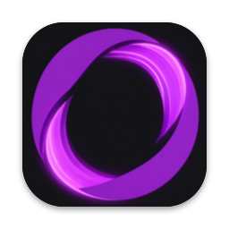
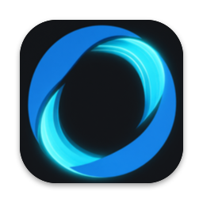

<p align="center"> </p>

# OpenRDP

[](https://github.com/org-event/OpenRDP/actions/workflows/ci.yml)
[](#license)

[Русская версия](README.ru.md)

An open RDP server for macOS, built on [IronRDP](https://github.com/Devolutions/IronRDP). Linux is planned. It lets you work on a remote Mac all day from any RDP client with GFX/H.264 support: Windows App (macOS, Windows, iOS), FreeRDP or Remmina (Linux).

## How it works

- **Capture**: ScreenCaptureKit, straight to NV12 full-range BT.709 (the AVC color space of MS-RDPEGFX), with no conversion.
- **Encoding**: VideoToolbox H.264, realtime, low latency, no B-frames.
- **Graphics**: the EGFX channel, AVC420 or AVC444. AVC444 is full-resolution colour, as Windows servers send it, so text and coloured edges stay sharp. It goes by default to FreeRDP-based clients, known by the advanced input channel they open; Windows App for Mac negotiates AVC444 and then drops the connection on it, so it gets AVC420. `--avc444` sends AVC444 to every client that negotiates it, `--no-avc444` to none. Windows App for Mac drops the connection on it, so it stays off by default. The surface is aligned to 16 and the extra pixels are cut off by a region.
- **Bitrate**: `--bitrate` (20 Mbit/s) is the ceiling. When frames are acknowledged well later than the best time seen on the connection, the server cuts the bitrate by a quarter, down to a quarter of the ceiling, and raises it back slowly while the acknowledgements stay quick. The frame rate follows the link by itself: at most three frames are in flight.
- **Sound**: what the Mac plays goes to the client over `rdpsnd`, as 16-bit PCM at 48 or 44.1 kHz (about 1.5 Mbit/s), captured by ScreenCaptureKit under the same Screen Recording permission. The Mac keeps playing through its own speakers. `--no-sound` turns it off; the login window has none.
- **Curtain**: the Mac's own displays go dark while a client is connected, if the client asks for it: its alternate shell is `curtain` (FreeRDP `/shell:curtain`, `alternate shell:s:curtain` in an .rdp file, a checkbox in OpenRDP Client). The server sets their gamma to black, so the people next to the Mac do not watch the session. The capture is unaffected, and the brightness comes back when the client leaves or the server stops, even if it crashes. The keyboard and mouse at the Mac still work: this hides the screen, it does not lock the Mac. `--curtain always` or `--curtain never` overrides the client.
- **Screen size**: a virtual display (`CGVirtualDisplay`) matches the client's window, in HiDPI, capped at 3072×1920 by area (`--max-size`) for clients that stretch the picture; a client that resizes the session to its window, like FreeRDP with `/dynamic-resolution`, gets the size it asks for, up to 4096 pixels a side, as far as the hardware encoder goes. It survives a disconnect for 5 minutes, so windows stay put when you reconnect.
- **Input**: `CGEventPost`. RDP scancodes are mapped to Mac keycodes: Win → Command, Alt → Option. Double clicks are counted.
- **Cursor**: sent as RDP pointer updates and drawn by the client, so it moves without video latency.
- **Clipboard**: text, images and files, both ways. Files copied in Finder are offered to the client, which reads them from disk as it pastes. Files copied on the client are downloaded into `~/Library/Caches/OpenRDP/Clipboard` (only the latest copy is kept) and put on the pasteboard, so Finder pastes them. A copy over 16 GB is not taken. FreeRDP on macOS may not paste files that come from the server, since it needs FUSE for that.
- **Drives**: a folder or drive the client redirects (FreeRDP `/drive:name,path`, Windows App "Folders") is mounted at `~/RDP Drives/<name>` while the client is connected, so Finder and every app can use it. A WebDAV server on 127.0.0.1, under a random path, turns each file call into RDPDR requests to the client, and the system's `mount_webdav` mounts it. It is slower than a local disk, and the first `cp` of a file after mounting can come out wrong (#22); Finder copies are right. `--no-drives` turns it off. A native FSKit volume is planned (#21).
- **Power**: the Mac stays awake while the server runs, and its display stays on while a client is connected. A connecting client wakes a sleeping display.

## Requirements

- A Mac with Apple Silicon (M1 or newer). Tested on macOS 27.
- Rust stable (`rustup`). The toolchain is pinned in `rust-toolchain.toml`.
- Screen Recording and Accessibility permissions, granted at the Mac itself (see below).

## Build and run

```bash
cargo build --release
./target/release/openrdp --user me --pass secret
```

The server listens on `0.0.0.0:3389` and authenticates with NLA. The user name and password are the server's own; they are not your macOS account. The password can also come from `OPENRDP_PASSWORD`. The TLS certificate is self-signed (RSA, because Windows App rejects ECDSA) and is created on first run in `~/Library/Application Support/openrdp`. Run `openrdp --help` for all options.

Do not open port 3389 to the internet: bots try passwords on it all day. From outside, reach the Mac through a VPN (WireGuard, Tailscale); `openrdp-doctor vpn` brings up a WireGuard tunnel. For the server it is an ordinary connection.

macOS grants Screen Recording and Accessibility to the app that started the server (Terminal, Ghostty and so on), and the server has to be restarted after granting them. The server asks for both on startup, so macOS adds that app to the lists:

- **Screen & System Audio Recording**: no picture without it;
- **Accessibility**: no keyboard or mouse without it.

To check the video path without any permissions, use `--test-pattern`. It sends a synthetic picture instead of the screen.

Check with FreeRDP:

```bash
sdl-freerdp /v:127.0.0.1 /u:me /p:secret /cert:ignore /gfx:avc420
```

In Windows App on a Mac, set the Command key to be sent as Windows: the host then sees it as Command.

## Start at login

Open the release disk image and drag OpenRDP onto Applications. The app is not notarized, so it stays in quarantine and will not open until you run `xattr -dr com.apple.quarantine /Applications/OpenRDP.app` in Terminal. The disk image shows that command. The first launch asks for the RDP name and password, warns before the administrator password, then walks through Screen Recording and Accessibility. The server starts only after both are on.

From a terminal, the same install is:

```bash
./target/release/openrdp install --user me --pass secret
```

That command asks for the administrator password with `sudo`.

This copies the server into `~/Applications/OpenRDP.app` and installs the LaunchAgent `com.openrdp.server`. The server starts when you log in and restarts if it crashes. The log goes to `~/Library/Logs/openrdp.log`. In this mode the permissions are granted to "OpenRDP" rather than to a terminal. The graphical install opens the right windows itself. From a terminal they still have to be granted at the Mac, and the server restarted afterwards:

```bash
launchctl kickstart -k gui/$(id -u)/com.openrdp.server
```

If an older install is still on disk, `install` removes that agent, `~/Applications/macRDP.app`, its log and `~/Library/Application Support/macrdp`. Nothing is carried over, so macOS asks for Screen Recording and Accessibility again.

After updating the build, run `install` again. It signs the app with a local certificate from a separate keychain in `~/Library/Application Support/openrdp`, so macOS recognises the new build as the same app and keeps the permissions. `openrdp uninstall` removes the agent, the app and the login-window service.

While the server is running it checks GitHub for a newer release. A dialog asks before installing; the connection drops for a moment while the new build replaces the app and the agent restarts. `--update auto` installs without asking, `--update off` does not check. "Later" asks again the next day.

`install` also installs a LaunchDaemon, `com.openrdp.broker`, and a login-window LaunchAgent, `com.openrdp.loginwindow`, and asks for an administrator password once. While the Mac shows the login window, launchd starts this same server inside that window's session. It runs as root there, as every login-window agent does, and the Screen Recording and Accessibility grants already given to OpenRDP apply. The stream is the physical display at its current size. Keys typed in the RDP client go to the login window, including the Mac password. After a successful login that process exits and the per-user LaunchAgent takes over; the client connects again. Logging out returns the server to the login window.

### RDP accounts

The accounts are the server's own, not macOS accounts, and there can be several: each person signs in with their own name and password and gets the same desktop, the one on the Mac's screen. A new sign-in takes over from the open session. They live in `~/Library/Application Support/openrdp/users`, mode 600, which the login-window server reads too. `install --user` adds its account there or sets its password; the rest is `openrdp user`:

```bash
openrdp user list
openrdp user set sergey        # asks for the password; or --pass / OPENRDP_PASSWORD
openrdp user rename ivan vanya
openrdp user remove sergey
```

Changes apply from the next connection, without a restart; an open session keeps running. The last account cannot be removed. NLA needs the password itself to check it, so the file keeps it in the clear and its mode is what protects it. An older install copies its password from the agent plist into this file on its first start; the next `install` drops it from the plist.

The FileVault screen before macOS has booted is still out of reach. RDP starts once the disk is unlocked and the login window is up. Until then, Screen Sharing can log you in: `ssh -N -L 5901:127.0.0.1:5900 you@mac` and then `vnc://127.0.0.1:5901`.

## Health check and wake: `openrdp-doctor`

[`scripts/openrdp-doctor`](scripts/openrdp-doctor) checks everything remote access depends on and can fix the common cases. It is meant to be run over SSH on the host:

```bash
scripts/openrdp-doctor           # check: session, agent, port, permissions, signing, power, network
scripts/openrdp-doctor wake      # wake the display
scripts/openrdp-doctor restart   # restart the agent
scripts/openrdp-doctor vpn       # bring up the WireGuard tunnel (needs a logged-in session)
```

On another machine, `openrdp-doctor wol <MAC> [broadcast]` sends a Wake-on-LAN packet to a Mac that is asleep (it needs Wake for network access on the host, `pmset womp 1`).

## Client app: OpenRDP Client

[`client/`](client) holds a small native Mac app (SwiftUI) that connects to OpenRDP servers through FreeRDP's `sdl-freerdp`, so you do not have to type the FreeRDP command by hand. A full build carries its own FreeRDP 3.32.2 with SDL3, FFmpeg (H.264 only) and OpenSSL inside the app, so the client Mac needs nothing else. Without it, the app uses FreeRDP from Homebrew (`brew install freerdp`) and looks for `sdl-freerdp` in `/usr/local/bin` (Intel) and `/opt/homebrew/bin` (Apple Silicon). Another path can be set in Settings. The app says so at once when `sdl-freerdp` is missing.

To install it, download `openrdp-client-<version>-universal.dmg` from the [releases](https://github.com/org-event/OpenRDP/releases). It runs on Apple Silicon and Intel Macs with macOS 13 or newer. Drag OpenRDP Client onto Applications. The app is not notarized, so take it out of quarantine once:

```bash
xattr -dr com.apple.quarantine "/Applications/OpenRDP Client.app"
```

Every CI run on a pull request or on `main` also leaves the disk image as the `openrdp-client-universal` artifact.

- **Saved Macs**: name, address, user and options. Passwords are kept in the Keychain. The app passes all options on `sdl-freerdp`'s stdin (`/args-from:stdin`), so the password does not show up in `ps` and is never written to a file.
- **One-click connect** with `/gfx:avc444 /dynamic-resolution /cert:tofu`, full screen or a window size, and a shared clipboard. `tofu` remembers the server's certificate on the first connection and refuses one that changes later. "Do not check" (`/cert:ignore`) is also available.
- **Dark Mac screen, if you want it.** Each saved Mac has a "Darken the Mac's screen during the session" checkbox, off by default. When it is on, the app passes `/shell:curtain`, and the OpenRDP server darkens its own displays until the client leaves. Other `/shell:` options in the extra parameters are joined to it with commas.
- **FreeRDP shortcuts without right Shift.** FreeRDP's default hotkey modifier is right Shift, which breaks capital П, К, В and Ь in the Russian layout, and right Shift+В disconnects. The app writes `SDL_KeyModMask` to `~/.config/freerdp/sdl-freerdp.json` (`$XDG_CONFIG_HOME/freerdp/` when that is set) and shows the shortcuts. The default is right ⌘ + right ⌥: with them, Enter toggles full screen, G toggles the keyboard grab, R toggles resizing, M minimizes and D disconnects.
- **⌘Space and other system shortcuts reach the remote Mac.** SDL's keyboard grab stops the client Mac from taking them only when SDL is built with `SDL_MAC_NO_SANDBOX`. The bundled SDL3 is. Homebrew's is not, so for it the app also loads a small library into `sdl-freerdp` (`DYLD_INSERT_LIBRARIES`, [`client/Keyboard/openrdp_keyboard.m`](client/Keyboard/openrdp_keyboard.m)). While FreeRDP grabs the keyboard (the pointer is over the session window) and the session window is active, it turns the client Mac's system shortcuts off, the same way SDL would. The OpenRDP server then gets ⌘Space and switches the layout. The library also clears ⌘Q, ⌘W, ⌘H and ⌘M from SDL's menu, so they go to the remote Mac instead of quitting or hiding the client. This can be turned off in Settings. To get the system shortcuts back to the local Mac during a session, press the modifier + G.

Build a universal (arm64 + x86_64) app with the Command Line Tools alone (Xcode is not needed):

```bash
brew install cmake ninja nasm pkgconf
client/build-freerdp.sh  # FreeRDP and its libraries for both architectures, once (about 20 minutes)
client/build.sh --dmg    # client/build/OpenRDP-Client-<version>.dmg with the app inside
```

`client/build-freerdp.sh` downloads the sources Homebrew uses and checks their SHA-256. Its result goes into the app only if it is there. `client/build.sh` alone makes the app without FreeRDP, and `--zip` packs a zip instead of a disk image.

The app is signed ad hoc. On another Mac, remove the quarantine after copying it: `xattr -dr com.apple.quarantine "/Applications/OpenRDP Client.app"`. After each new build macOS asks once for access to the saved passwords in the Keychain: choose "Always Allow". Session logs are in `~/Library/Logs/OpenRDP Client/`.

## Open questions

The roadmap and design notes are in [docs/plan.md](docs/plan.md) (in Russian). Main gaps:

- Intel Macs.

## Contributing

Contributions are welcome. See [CONTRIBUTING.md](CONTRIBUTING.md). Report security issues privately as described in [SECURITY.md](SECURITY.md).

## License

Licensed under either of

- Apache License, Version 2.0 ([LICENSE-APACHE](LICENSE-APACHE))
- MIT license ([LICENSE-MIT](LICENSE-MIT))

at your option.

Unless you explicitly state otherwise, any contribution intentionally submitted for inclusion in the work by you, as defined in the Apache-2.0 license, shall be dual licensed as above, without any additional terms or conditions.
